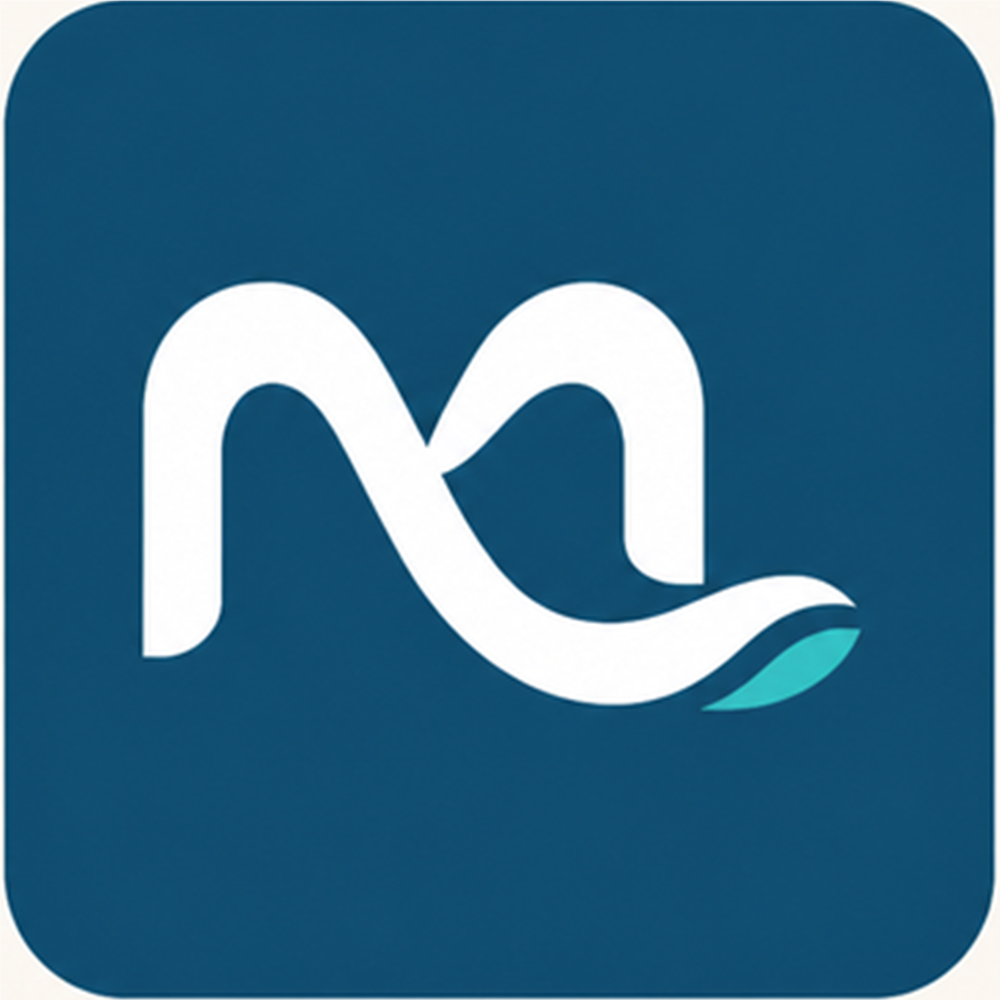

# Documentación del proyecto — Mi Ciudad Colón

<p align="center">
  
</p>

**Versión:** 1.0.0  
**Tipo:** MVP académico para dispositivos móviles  
**Ciudad:** Colón, Entre Ríos, Argentina  
**Tecnología principal:** React Native con Expo y TypeScript

**Institución:** Universidad Nacional de Entre Ríos — FCAD

## Equipo — Grupo 75

- Gustavo Minchiotti
- Francisco López
- Alicia Montenegro
- Jimena Fernández

## 1. Presentación

Mi Ciudad Colón es una guía turística móvil pensada para acompañar a una persona durante su visita a la ciudad. La propuesta reúne lugares de interés, eventos, recorridos y recuerdos de cada visita en una sola experiencia.

El proyecto se construyó con un alcance acotado y demostrable. No intenta reemplazar todos los servicios turísticos de la ciudad ni presentarse como una plataforma productiva. La prioridad fue implementar el flujo principal del PDR, dejar una base ordenada y documentar las decisiones que pueden continuarse en una próxima etapa.

## 2. Problema que se busca resolver

La información turística suele estar repartida entre mapas, redes sociales, páginas web y recomendaciones informales. Esto dificulta decidir qué hacer según el tiempo disponible, la distancia y los intereses de cada visitante.

La aplicación propone una entrada más simple:

1. La persona explora lugares o eventos.
2. Consulta la información principal de cada propuesta.
3. Guarda favoritos o arma un recorrido.
4. Registra las visitas realizadas.
5. Puede agregar una nota o una fotografía como recuerdo.

## 3. Alcance funcional

### Incluido en el MVP

- Inicio con acceso a las funciones principales.
- Catálogo de lugares turísticos con categorías e imágenes.
- Detalle de cada lugar con descripción, ubicación y acciones relacionadas.
- Agenda de eventos.
- Recorrido personal a partir de lugares seleccionados.
- Favoritos persistentes.
- Registro de visitas por QR, ubicación o carga manual.
- Nota y fotografía asociadas a una visita.
- Mapa y cálculo de distancia cuando el dispositivo entrega ubicación.
- Inicio de sesión y registro contra la API cuando está configurada.
- Persistencia local de catálogo, preferencias y visitas.
- Cola local para visitas que todavía no pudieron sincronizarse.
- Pantallas de permisos para ubicación, cámara, galería, notificaciones y biometría.
- Audioguías preparadas para los contenidos que tengan un recurso disponible.

### Fuera del alcance actual

- Panel administrativo para cargar contenido.
- Moderación de fotografías y comentarios.
- Pagos, reservas o venta de entradas.
- Chat con prestadores turísticos.
- Notificaciones push remotas listas para producción.
- Subida multipart de fotografías locales al servidor.
- Pruebas automatizadas completas.

Dejar estas tareas explícitamente fuera del MVP ayuda a no confundir una demostración académica con un producto terminado.

## 4. Tecnologías elegidas

| Área | Tecnología | Motivo de elección |
|---|---|---|
| App móvil | React Native | Permite trabajar con una base compartida para Android e iOS. |
| Entorno | Expo SDK 58 | Simplifica el arranque, las pruebas y el acceso a módulos del dispositivo. |
| Navegación | Expo Router | Organiza las pantallas a partir de rutas y carpetas. |
| Lenguaje | TypeScript | Ayuda a detectar errores en los modelos y servicios. |
| Persistencia | SQLite y `expo-sqlite/kv-store` | Permite conservar visitas, caché y preferencias en el teléfono. |
| API | HTTP/JSON con `fetch` | Mantiene la integración simple y compatible con la API provista. |
| Diseño | Manrope, colores de marca y componentes propios | Busca una identidad turística moderna y consistente. |

## 5. Arquitectura general

La aplicación está separada en capas pequeñas. No se utiliza una arquitectura compleja porque el tamaño actual del proyecto no la necesita.

```text
Pantallas de Expo Router
          │
          ▼
Contexto global de la aplicación
          │
          ├── Servicios de dominio
          │      ├── API HTTP
          │      ├── ubicación y distancias
          │      ├── sesión y seguridad
          │      └── visitas y notificaciones
          │
          └── Persistencia local
                 ├── SQLite: visitas pendientes y sincronización
                 ├── KV store: catálogo y categorías
                 └── Secure Store: tokens de sesión
```

### Responsabilidad de las carpetas

- `src/app`: rutas, pantallas, layouts y modales.
- `src/components`: piezas visuales que se reutilizan en más de una pantalla.
- `src/contexto`: sesión, favoritos, conectividad, catálogo y visitas.
- `src/servicios`: comunicación externa y capacidades del dispositivo.
- `src/almacenamiento`: lectura y escritura local.
- `src/mocks`: datos de respaldo para que el proyecto también pueda demostrarse sin API.
- `src/tipos`: contratos TypeScript para lugares, eventos, usuarios y visitas.
- `src/theme`: colores, tipografías y estilos asociados a la marca.

## 6. Navegación de la app

```text
Inicio
├── Lugares
│   └── Detalle del lugar
├── Agenda
│   └── Detalle del evento
├── Mi recorrido
│   └── Mapa / puntos seleccionados
└── Yo
    ├── Favoritos
    ├── Mis visitas
    ├── Registro manual
    └── Acceso / registro

Acciones transversales:
├── Escanear QR
├── Usar ubicación
├── Elegir fotografía
└── Reproducir audioguía
```

## 7. Integración con la API

La URL se obtiene desde `EXPO_PUBLIC_API_URL`. La capa `src/servicios/api.ts` centraliza:

- construcción de URLs;
- encabezado `Authorization: Bearer` cuando hay sesión;
- serialización JSON;
- timeout de ocho segundos;
- conversión de respuestas no exitosas a `ApiHttpError`.

La app intenta usar datos remotos cuando la API está configurada. Si esa consulta falla, los servicios pueden recuperar el catálogo local de respaldo. La visita tiene un tratamiento diferente: primero se guarda en el teléfono y luego se intenta sincronizar con `POST /yo/visitas`.

La sincronización actual funciona de esta manera:

1. Se registra la visita en la tabla local `visitas` con `sincronizada = 0`.
2. Si existe sesión y API disponible, se intenta enviarla.
3. Si el servidor responde correctamente, se marca como sincronizada.
4. Si falla la red, el registro permanece local para reintentarlo.

Las fotografías elegidas desde el dispositivo todavía no se suben al servidor. Se conserva su URI local y se envía solamente una URL remota cuando ya existe. Esta es una limitación conocida y no se presenta como una funcionalidad terminada.

## 8. Permisos y privacidad

La aplicación puede solicitar:

- **Ubicación:** mostrar lugares cercanos y calcular distancias.
- **Cámara:** leer códigos QR y registrar una visita.
- **Galería:** asociar una fotografía a un recuerdo.
- **Notificaciones:** avisos locales o futuros recordatorios.
- **Biometría:** facilitar el reingreso al dispositivo.

Los permisos se consideran opcionales para la experiencia base. Si una persona los rechaza, la app debe continuar ofreciendo el catálogo y las funciones que no dependan de ese permiso.

Los tokens no se guardan en texto plano dentro de archivos del proyecto. El archivo `.env` solo sirve para configurar una dirección de API durante el desarrollo y está excluido del repositorio.

## 9. Instalación para desarrollo

1. Clonar el repositorio privado desde GitHub.
2. Instalar Node.js LTS y comprobar `node --version` y `npm --version`.
3. Ejecutar `npm.cmd install`.
4. Ejecutar `npm.cmd run typecheck`.
5. Iniciar Expo con `npm.cmd start -- --clear`.
6. Abrir el QR desde Expo Go SDK 58 o utilizar un emulador Android.

Para usar la API:

```powershell
Copy-Item .env.example .env
```

Después se completa `EXPO_PUBLIC_API_URL` con la dirección accesible desde el teléfono. Una IP `localhost` de la computadora no funciona directamente desde un dispositivo físico.

## 10. Verificación realizada

Las comprobaciones básicas del proyecto son:

```powershell
npm.cmd run typecheck
npx expo-doctor
npx expo export --platform android
```

También se probó el flujo de apertura con Expo Go en Android, la carga del catálogo, el uso de imágenes reales, la navegación principal y la persistencia local.

La verificación no equivale todavía a una batería de pruebas automatizadas. En una etapa posterior sería conveniente agregar pruebas unitarias para servicios y pruebas de recorrido para login, favoritos, registro de visitas y sincronización.

## 11. Limitaciones conocidas

- La API puede no tener información completa para todos los campos del PDR.
- La experiencia offline depende de que el catálogo haya sido guardado previamente.
- El envío de fotografías al backend todavía no está implementado.
- Las notificaciones push remotas requieren un development build y configuración adicional.
- El cálculo de distancia depende del permiso y de la precisión de ubicación del dispositivo.
- El proyecto se verificó principalmente en Android; iOS requiere una pasada específica.
- Todavía falta una revisión sistemática de accesibilidad, rendimiento y licencias de imágenes.

## 12. Próximos pasos razonables

1. Completar pruebas manuales en un dispositivo Android y un emulador.
2. Agregar pruebas unitarias para API, almacenamiento y sincronización.
3. Implementar la carga segura de fotografías.
4. Definir contenidos y archivos definitivos para las audioguías.
5. Revisar textos, contraste, tamaños táctiles y accesibilidad.
6. Configurar un build de demostración con EAS.
7. Reemplazar datos de respaldo por un catálogo administrable cuando exista un backend estable.

## 13. Criterio de cierre del MVP

Para considerar cumplida la entrega académica, la aplicación debe poder abrir, mostrar el catálogo, navegar hacia un detalle, consultar la agenda, armar un recorrido, registrar una visita y conservar datos básicos aunque la API no esté disponible. Las limitaciones restantes quedan registradas para que el siguiente desarrollo tenga un punto de partida claro.
