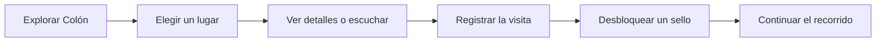

<p align="center">
  
</p>

<h1 align="center">Mi Ciudad Colón</h1>

<p align="center">Guía turística móvil para descubrir Colón, Entre Ríos, y conservar cada recorrido.</p>

<p align="center">
  
  
  
  
  
</p>

<p align="center">
  <a href="DOCUMENTACION_PROYECTO.md">Documentación</a> ·
  <a href="CHANGELOG.md">Versiones</a> ·
  <a href="QR_PRUEBAS.html">QR de prueba</a>
</p>

Aplicación móvil turística para descubrir Colón, Entre Ríos. El proyecto está planteado como un MVP académico: busca resolver el recorrido principal del PDR con una base clara, mantenible y fácil de continuar.

La app permite explorar lugares, consultar eventos, armar un recorrido personal, completar un pasaporte turístico visual, registrar visitas y guardar recuerdos. También contempla ubicación, códigos QR, favoritos, audioguías y funcionamiento con datos locales cuando la conexión no está disponible.

## Experiencia principal

- 🗺️ **Descubrir:** mapa, cercanía, filtros y detalles de lugares.
- 👣 **Recorrer:** visitas por QR, GPS o registro manual.
- 🎟️ **Recordar:** pasaporte turístico, sellos, fotos y notas.
- 🎧 **Escuchar:** narraciones y audioguías descargables.
- 📅 **Planificar:** agenda y recordatorios de eventos.
- 📴 **Continuar sin señal:** catálogo local, visitas pendientes y sincronización posterior.

## Recorrido de uso



**Equipo:** Grupo 75

**Institución:** Universidad Nacional de Entre Ríos — FCAD

- Gustavo Minchiotti
- Francisco López
- Alicia Montenegro (Viviana)
- Jimena Fernández

## Documentación

- [Documentación funcional y técnica](DOCUMENTACION_PROYECTO.md)
- [Historial completo de versiones](CHANGELOG.md)
- [Plancha de códigos QR para pruebas](QR_PRUEBAS.html)

## Estado actual

| Componente | Estado |
|---|---|
| Aplicación Android | Versión 1.0.3 validada en Pova 6 |
| Cliente HTTP | Axios centralizado |
| API | Cloud Run con HTTPS público |
| Base de datos | PostgreSQL en Supabase |
| Archivos | Supabase Storage |
| Persistencia móvil | SQLite, KV Store y SecureStore |
| Validación física | Pova 6; faltan más tamaños y TalkBack |

## Ejecutar el proyecto

Requisitos mínimos:

- Node.js LTS.
- npm.
- Android Studio y Android SDK para usar un emulador o un dispositivo Android.
- Expo Go compatible con SDK 58 para la prueba rápida en un teléfono.

Desde la carpeta del proyecto:

```powershell
npm.cmd install
npm.cmd run typecheck
npm.cmd start -- --clear
```

El servidor muestra un código QR. Para abrirlo con Expo Go, el teléfono y la computadora deben estar conectados a la misma red Wi-Fi. Si la red bloquea la conexión local, se puede probar con un emulador Android o con el modo de túnel de Expo.

## Estructura principal

```text
src/
├── app/              # pantallas y rutas de Expo Router
├── components/       # componentes visuales reutilizables
├── contexto/         # estado compartido de la aplicación
├── almacenamiento/   # SQLite, caché y preferencias
├── mocks/            # datos de respaldo para desarrollo
├── servicios/        # API, ubicación, notificaciones, archivos y sesión
├── theme/            # colores y decisiones visuales de marca
└── tipos/            # modelos TypeScript del dominio
```

## Datos y API

Cuando existe `EXPO_PUBLIC_API_URL`, la app consulta la API de Mi Ciudad para lugares, categorías, eventos, autenticación, favoritos y visitas. La APK de demostración usa una API HTTPS en Cloud Run, con PostgreSQL y archivos en Supabase; el teléfono puede acceder desde otra red.

La comunicación HTTP utiliza Axios mediante una instancia central configurada en `src/servicios/api.ts`. Esa capa incorpora la URL base, los tiempos de espera, el token de sesión, los cuerpos JSON, la carga de fotos con `FormData` y la conversión de fallos a errores propios de la app. Las pantallas no se conectan directamente al servidor.

El catálogo se guarda en caché local. Las visitas pendientes se conservan en SQLite y los favoritos mantienen una cola por cuenta, tanto para agregar como para quitar lugares. Se reintenta al recuperar conexión o volver a la app. En **Yo → Sincronizar cuenta** se puede pedir un nuevo intento y consultar si quedan cambios pendientes. Los datos guardados sin sesión permanecen en el perfil anónimo del teléfono.

Si no se configura la API o el servidor no responde, se utiliza el catálogo local de respaldo. Esta decisión permite presentar el recorrido principal sin que una caída de red deje la app completamente vacía.

## Sistema de códigos QR

Mi Ciudad usa códigos QR para registrar visitas turísticas. Cada código contiene el identificador del lugar con el formato `COLON:lug-XXX`. Al escanearlo, la app:

1. valida el código contra la API o el catálogo local;
2. rechaza códigos que no pertenecen a Mi Ciudad;
3. verifica que el QR corresponda al lugar esperado cuando se abre el lector desde un detalle;
4. guarda la visita primero en SQLite;
5. la sincroniza con la API cuando vuelve la conexión.

Los códigos de prueba están en [QR_PRUEBAS.html](QR_PRUEBAS.html) y en `assets/qr-prueba/`. La plancha incluye ocho códigos válidos y uno inválido para comprobar el rechazo del lector. Para regenerarlos se puede ejecutar:

```powershell
powershell.exe -NoProfile -ExecutionPolicy Bypass -File ".\scripts\generar-qrs.ps1"
```

El lector necesita permiso de cámara. Si el permiso se rechaza, se puede continuar con el registro manual o por ubicación.

Para activar la API de forma local:

```powershell
Copy-Item .env.example .env
# Editar .env y colocar la dirección de la computadora que ejecuta la API.
```

La API de referencia y sus instrucciones están en el repositorio de la cátedra: [api-proyectos-mobile](https://github.com/franco-ruisdias-uner/api-proyectos-mobile/tree/main/api-mi-ciudad).

## Seguridad básica

- Los tokens de sesión se guardan mediante `expo-secure-store`.
- `.env` está excluido de Git y solo `.env.example` se comparte como plantilla.
- Las variables `EXPO_PUBLIC_` no deben contener contraseñas, claves privadas ni secretos.
- La app solicita permisos con textos explicativos y solo cuando la función los necesita.

## Comandos útiles

```powershell
npm.cmd run typecheck
npm.cmd start -- --clear
npm.cmd run android
npx expo-doctor
npx expo export --platform android
```

El proyecto se considera una entrega académica. Antes de una publicación real falta completar la validación en distintos teléfonos y en iOS, probar TalkBack y comprobar el envío push remoto de punta a punta. Recibir un recordatorio programado en el teléfono acredita una notificación local.

La versión 1.0.2 incluye ajustes de áreas seguras para las barras de Android. En el Pova 6 se instaló sobre la versión anterior, se comprobaron los márgenes y se guardó la audioguía de Molino Forclaz: permaneció disponible tras cerrar y abrir la APK y se reprodujo en modo avión. El registro con la API pública se comprobó en la versión 1.0.1; todavía falta validar la recuperación de datos entre dos teléfonos. La lectura de la descripción depende de las voces instaladas en el dispositivo y se distingue de una audioguía descargada como archivo.

La versión 1.0.3 se instaló como actualización en el mismo equipo, conservando la firma y los datos existentes. Se verificaron el inicio, las áreas seguras, el catálogo y el registro de una cuenta temporal contra la API pública mediante Axios. Al terminar la prueba se cerró la sesión y se eliminaron los datos temporales.

La API de demostración ofrece ocho narraciones MP3 de las descripciones, sintetizadas en español de EE. UU. y almacenadas en Supabase. La app reproduce y descarga esos archivos con `expo-audio`; no necesita credenciales de Text-to-Speech. Los demás lugares conservan la lectura con la voz del teléfono.
