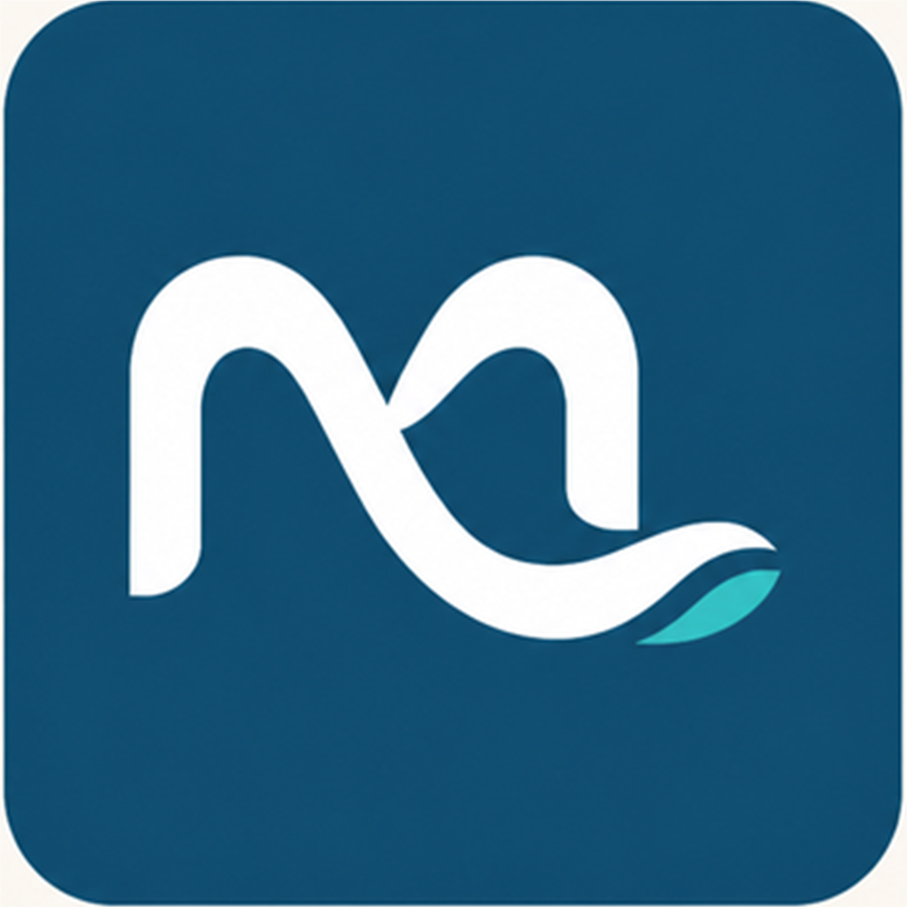

# Mi Ciudad Colón

<p align="center">
  
</p>

Aplicación móvil turística para descubrir Colón, Entre Ríos. El proyecto está planteado como un MVP académico: busca resolver el recorrido principal del PDR con una base clara, mantenible y fácil de continuar.

La app permite explorar lugares, consultar eventos, armar un recorrido personal, completar un pasaporte turístico visual, registrar visitas y guardar recuerdos. También contempla ubicación, códigos QR, favoritos, audioguías y funcionamiento con datos locales cuando la conexión no está disponible.

**Equipo:** Grupo 75

**Institución:** Universidad Nacional de Entre Ríos — FCAD

- Gustavo Minchiotti
- Francisco López
- Alicia Montenegro
- Jimena Fernández

## Documentación

- [Documentación funcional y técnica](DOCUMENTACION_PROYECTO.md)

## Ejecutar el proyecto

Requisitos mínimos:

- Node.js LTS.
- npm.
- Android Studio y Android SDK para usar un emulador o un dispositivo Android.
- Expo Go compatible con SDK 58 para la prueba rápida en un teléfono.

Desde la carpeta del proyecto:

```powershell
npm.cmd install
npm.cmd run typecheck
npm.cmd start -- --clear
```

El servidor muestra un código QR. Para abrirlo con Expo Go, el teléfono y la computadora deben estar conectados a la misma red Wi-Fi. Si la red bloquea la conexión local, se puede probar con un emulador Android o con el modo de túnel de Expo.

## Estructura principal

```text
src/
├── app/              # pantallas y rutas de Expo Router
├── components/       # componentes visuales reutilizables
├── contexto/         # estado compartido de la aplicación
├── almacenamiento/   # SQLite, caché y preferencias
├── mocks/            # datos de respaldo para desarrollo
├── servicios/        # API, ubicación, notificaciones, archivos y sesión
├── theme/            # colores y decisiones visuales de marca
└── tipos/            # modelos TypeScript del dominio
```

## Datos y API

Cuando existe `EXPO_PUBLIC_API_URL` en un archivo `.env`, la app consulta la API de Mi Ciudad para lugares, categorías, eventos, autenticación y visitas. El catálogo se guarda en caché local y las visitas pendientes se conservan en SQLite para intentar sincronizarlas más adelante.

Si no se configura la API o el servidor no responde, se utiliza el catálogo local de respaldo. Esta decisión permite presentar el recorrido principal sin que una caída de red deje la app completamente vacía.

Para activar la API de forma local:

```powershell
Copy-Item .env.example .env
# Editar .env y colocar la dirección de la computadora que ejecuta la API.
```

La API de referencia y sus instrucciones están en el repositorio de la cátedra: [api-proyectos-mobile](https://github.com/franco-ruisdias-uner/api-proyectos-mobile/tree/main/api-mi-ciudad).

## Seguridad básica

- Los tokens de sesión se guardan mediante `expo-secure-store`.
- `.env` está excluido de Git y solo `.env.example` se comparte como plantilla.
- Las variables `EXPO_PUBLIC_` no deben contener contraseñas, claves privadas ni secretos.
- La app solicita permisos con textos explicativos y solo cuando la función los necesita.

## Comandos útiles

```powershell
npm.cmd run typecheck
npm.cmd start -- --clear
npm.cmd run android
npx expo-doctor
npx expo export --platform android
```

El proyecto todavía se considera una entrega académica. Antes de una publicación real habría que completar pruebas automatizadas, una validación manual con TalkBack, la configuración de credenciales para notificaciones remotas y una estrategia de despliegue.
